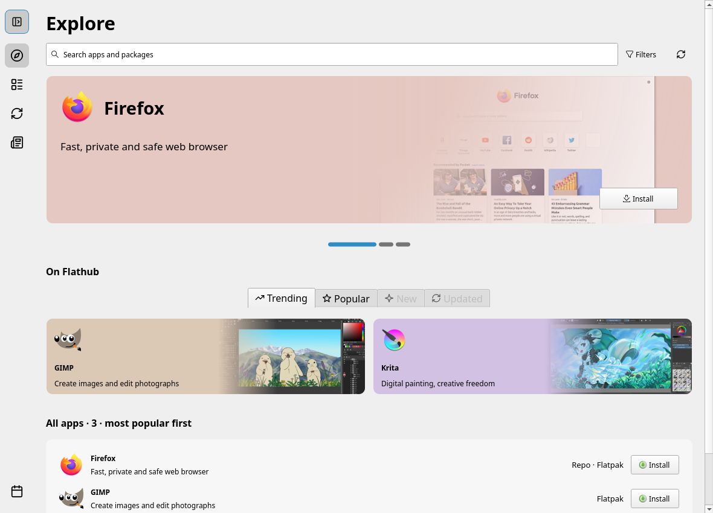
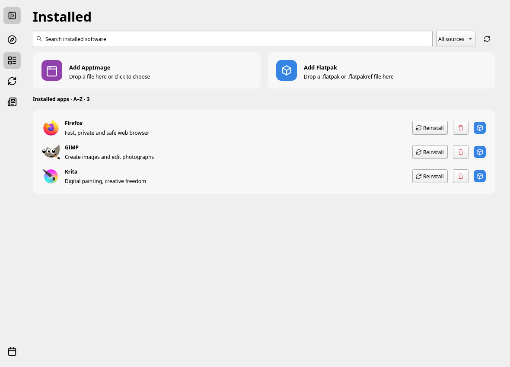
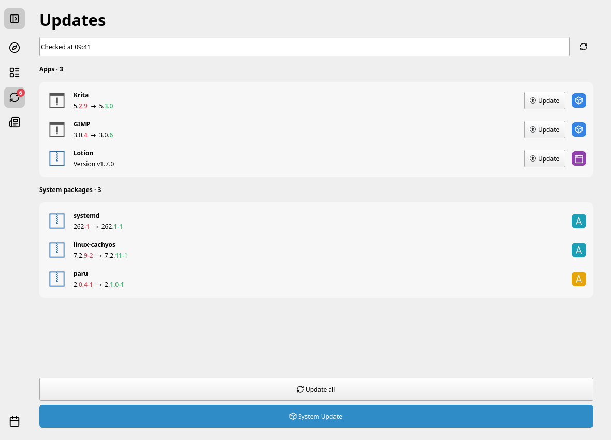
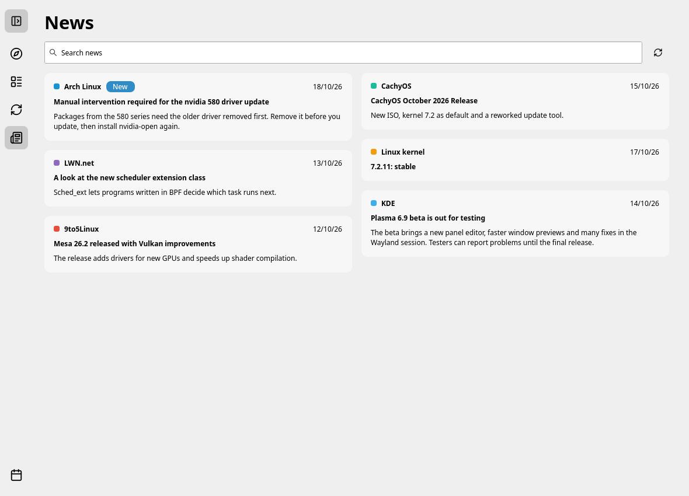

# WoofStore

A native Qt 6 / KDE software store and system updater for CachyOS and Arch Linux. It shows apps from Flathub, every pacman repository and the AUR in one catalogue, installs them, keeps them updated, and shows Arch and CachyOS news.



| Installed | Updates | News |
|---|---|---|
|  |  |  |

Screenshots use the small sample catalogue of the test suite.

## Install

On Arch Linux or CachyOS:

```bash
curl -fsSL https://raw.githubusercontent.com/LaskyWolf/woofstore/main/install.sh | bash
```

The script builds a normal pacman package (`woofstore`) and installs it. It asks for your password through `sudo`, and pacman asks you to confirm. Run the same command again to update. To uninstall:

```bash
curl -fsSL https://raw.githubusercontent.com/LaskyWolf/woofstore/main/install.sh | bash -s -- --uninstall
```

From a clone of this repository, `makepkg -si` does the same.

Optional programs: `flatpak` for Flathub apps, `paru` for AUR packages and AUR updates, `devtools` to build AUR packages in a clean chroot.

## What it does

- **Explore:** every app from Flathub, the pacman repositories (including CachyOS) and the AUR. The same app from several sources is one entry with a source menu. Search suggests names as you type; packages without app metadata appear under Other packages. The home page has featured apps and a Trending / Popular / New / Updated module for Flathub. The search and filters stay at the top while you scroll.
- **Installed:** the apps in your application menu, like the Start menu: Flatpaks, Arch packages, AUR/local packages, AppImages and other launchers (Steam game shortcuts are left out). Add AppImage and Add Flatpak accept files by click or drop and use the normal install window.
- **Updates:** checks Arch, AUR, Flatpak and AppImage updates when the store starts and on demand.
  - **Update all** updates everything in the list: the system first, then AUR, Flatpak and AppImages.
  - **System Update** runs a full system upgrade (`pacman -Syu`) and the AUR updates. Arch does not support updating one package alone, so the Arch rows have no button of their own. The button takes the accent colour while the system has updates and is grey otherwise. The sidebar badge is red when the system has updates and accent-coloured when only apps do.
  - If `pacman -Syu` fails, nothing else is updated. A failure in the AUR, Flatpak or AppImage step is reported and the next step still runs.
  - **Development (git) packages:** their version number rarely changes, so the list cannot show when they have news. The confirmation window has an option that adds `paru --devel`: paru asks each project for new commits and rebuilds the ones that have some. It is slower.
  - AUR updates are built without the review step the store requires for a first install.
  - After an update that installs a new kernel, a desktop notification offers to restart.
- **News:** cards with cover pictures in two or three columns, with search, from Arch Linux, CachyOS, the Linux kernel, KDE, LWN.net, 9to5Linux, Phoronix, GamingOnLinux, OMG! Ubuntu, Fedora Magazine, Linuxiac and It's FOSS. The page starts with the newest two articles per source; Show more adds more. Unread news from Arch Linux and CachyOS put an accent badge on the sidebar icon.
- **Desktop links:** the installer makes WoofStore the program for `appstream:` links. KRunner's "Install" suggestions for apps you do not have open on that app's page. Starting the store again hands the request to the open window. By hand: `gio mime x-scheme-handler/appstream io.github.laskywolf.WoofStore.desktop`.
- **Activity:** history of package operations. Click an entry to reopen its window.

Run the store as your normal user. Package managers ask for elevated privileges only when needed: polkit for `pkexec`, a KDialog or Zenity prompt for the `sudo` that `pkgctl` and `paru` use.

## Installing and removing

Install, Reinstall and Remove run the real package manager in the background, one operation at a time, with a progress window (steps, one status line, "Show details" for the raw output).

- **Flatpak:** `flatpak install --system -y <remote> <id>`.
- **Repository:** `pkexec pacman -S --needed --noconfirm <name>`.
- **AUR:** the store downloads the build files, shows the AUR facts (maintainer, votes, dates), lists lines to read twice (downloads, `curl | sh`, install scripts, unusual source hosts, skipped checksums) and shows what changed since you last approved the package. The Build button stays off until you tick "I read the recipe". It then builds with `pkgctl build` in a clean chroot (package `devtools`) and installs only the built file with `pkexec pacman -U`. A chroot keeps the build away from your files; it is not a sandbox, and the installed package runs as root. Build dependencies from the AUR are not resolved. Builds happen under `~/.cache/WoofStore/aur-build`, not `/tmp`.
- **AppImage:** copied to `~/.local/share/WoofStore/appimages` and added to the app menu, without being run. Updates need the update information the publisher embeds in the file (`gh-releases-zsync` or `zsync`): the store compares the checksum of your file with the one the publisher lists, and a newer file replaces the old one.
- **Remove:** a dialog asks what else to delete. Caches are pre-selected; settings and data (`~/.config`, `~/.local/share`, `~/.var/app`) are not. Only folders whose name equals the app or package name are offered.
- **Open:** Flatpaks start with `flatpak run`; other apps through their desktop file.

Pacman installs can cause a partial upgrade if your repository database is newer than your system; run System Update first.

## Network

The store contacts only these services: Flathub (catalogue, statistics), the Arch mirrors through `pacman`, the AUR, pkgstats and odrs.gnome.org (ratings, with the Flatpak ID of the app you open), api.github.com and the AppImage publisher's release files (AppImage updates), the news sources above, and duckduckgo.com (a short description for an installed app that no package database knows). Answers are cached in `~/.cache/WoofStore`.

## Development

Install the dependencies:

```bash
sudo pacman -S --needed base-devel cmake qt6-base kcoreaddons kparts konsole breeze-icons appstream-qt archlinux-appstream-data expac pacman-contrib polkit git flatpak
```

Build, test and run:

```bash
cmake -S . -B build -DCMAKE_BUILD_TYPE=Release
cmake --build build -j2
ctest --test-dir build --output-on-failure
./build/woof-store
```

If no Flatpak catalogue is available, configure a remote and restart the store:

```bash
flatpak remote-add --user --if-not-exists flathub https://dl.flathub.org/repo/flathub.flatpakrepo
flatpak update --user --appstream
```

Catalogue data:

- Repository apps get names, icons and screenshots from `archlinux-appstream-data`. Without it, Explore shows the install command.
- The AUR package list downloads once a day (about 10 MB). Popularity rankings from Flathub and pkgstats refresh daily. Screenshots download on first view (at most 200 MB of cache).
- To add descriptions or icons for CachyOS and AUR apps, or to fix a wrong merge, see [metadata/README.md](metadata/README.md).
- `./build/woof-store --catalog-stats` prints source counts, merge results, load time and memory use.

Previews and checks run without installing anything and use the small catalogue in `tests/fixtures/`:

```bash
QT_QPA_PLATFORM=offscreen ./build/woof-store --page news --screenshot /tmp/news.png
QT_QPA_PLATFORM=offscreen ./build/woof-store --updates-preview available --screenshot /tmp/updates.png
QT_QPA_PLATFORM=offscreen ./build/woof-store --installed-preview --screenshot /tmp/installed.png
QT_QPA_PLATFORM=offscreen ./build/woof-store --explore-bottom --screenshot /tmp/explore.png
```

`--help` lists every preview and check option. `--updates-preview` takes `idle`, `checking`, `failed`, `available` or `apps`. Add `--live-catalog` to a screenshot preview to use the live sources.

## License

GPL-3.0-or-later. See [LICENSE](LICENSE).
